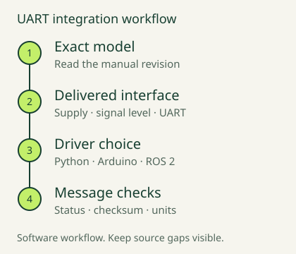

# ErdiLRF — Arduino UART driver

Arduino driver for [ERDI](https://erdilrf.com) 905 nm laser rangefinder modules over UART.
The API accepts an Arduino `Stream` transport. Host UART capabilities and the delivered
module interface must be checked for the selected configuration; a library entry is not
a hardware-compatibility or electrical-level guarantee.

[Install](#install) · [First reading](#first-reading) · [Examples](#usage) · [Model scope](#model-identifiers-and-validation-scope)



## First reading

1. Confirm the exact model, manual revision, delivered UART interface, supply and
   signal levels before wiring.
2. Install `ErdiLRF`, then open [BasicMeasure](examples/BasicMeasure/BasicMeasure.ino).
   Select `ERDI_TARGET_MODEL` and configure the host UART for your board.
3. Read the status and distance output together. Keep unresolved model-specific
   limits visible; an example sketch does not prove hardware compatibility.

For a streaming module, use [ContinuousStream](examples/ContinuousStream/ContinuousStream.ino)
and read the selected model's protocol notes first.

## Install

- **Arduino IDE / Arduino CLI Library Manager**: Sketch -> Include Library -> Manage Libraries ->
  search `ErdiLRF` -> Install. The
  [registry submission](https://github.com/arduino/library-registry/pull/9133)
  has been accepted. If your local index is out of date, refresh it or use Git below.
- **From Git**: `arduino-cli lib install --git-url https://github.com/ErdiTech/ErdiLRF`
  or clone/copy this repository into your sketchbook's `libraries/` folder.
- **PlatformIO**: add to `platformio.ini`:
  ```ini
  lib_deps =
      erdi-tech/ErdiLRF
  ```
  See the [PlatformIO Registry](https://registry.platformio.org/libraries/erdi-tech/ErdiLRF)
  for published versions.
  Git installation remains available with
  `https://github.com/ErdiTech/ErdiLRF.git`.

## Model identifiers and validation scope

The library source contains these model identifiers:

`LR1000E2`, `LR1000E4`, `LR1200E2`, `LR1200E4`, `LR1500E2`, `LR1500E4`,
`LR2000E2`, `LR2000E4`, `LRF1200A1`, `LRF3000A1`, `SPD1200N0`, `SPD1200N2`,
`SPD1200N4`, `SPD1200D03`, `LRF50H`, `LRF100H`, `LRF200H`, `LRF300H`,
`LRF600H`, `LRF1500H`, `LRF22VB`, `LRF50VB`.

Select the exact model and manual revision before interpreting a reading. A common frame
header does not establish a common distance unit, baud rate, supply, signal voltage,
checksum interpretation or safety classification. Check the delivered unit's configuration
and interface before wiring; a supply-voltage value is not a TX/RX logic-level specification.

`SPD1200D03` has conflicting baud-rate statements in its source manual. The library does
not choose an automatic baud for it; confirm the delivered setting. Other documented
source discrepancies remain unresolved, including the LRF50VB command-table/checksum
mismatch and the LRF1500H checksum/sentinel examples. Do not treat this documentation
update as resolving those issues or validating every model against hardware.

For model documents and configuration questions, use the
[model catalogue](https://erdilrf.com/models/) and
[product enquiry form](https://erdilrf.com/contact/).

## Usage

```cpp
#include <ErdiLRF.h>

static const ErdiModel ERDI_TARGET_MODEL = ERDI_LRF3000A1;
```

See the bundled examples:

- [`BasicMeasure`](examples/BasicMeasure/BasicMeasure.ino) -- single-shot ranging.
- [`ContinuousStream`](examples/ContinuousStream/ContinuousStream.ino) -- free-running stream mode.

A step-by-step wiring and first-reading walkthrough is here:
[Read a laser distance module over Arduino UART](https://erdilrf.com/knowledge/read-laser-distance-module-arduino-uart/).

## Also available

- Python driver: install the published GitHub release wheel:
  ```bash
  pip install https://github.com/ErdiTech/erdi-lrf-drivers/releases/download/v0.1.0/erdi_lrf-0.1.0-py3-none-any.whl
  ```
  See the [Python installation guide](https://github.com/ErdiTech/erdi-lrf-drivers#install-in-one-command).
- ROS 2 node:
  [`ros2/erdi_lrf_ros2`](https://github.com/ErdiTech/erdi-lrf-drivers/tree/main/ros2/erdi_lrf_ros2)
  in the same mono-repo. Its documented validation does not include a live ROS 2 runtime test.

This repository is a maintained split of `arduino/ErdiLRF` from that mono-repo, published
standalone so it can be registered with the Arduino Library Manager and the PlatformIO
Registry. Arduino Library Manager tracks repository tags; PlatformIO packages are
published separately.

## License

MIT -- see [LICENSE](LICENSE).

## Contact

ERDI TECH LTD · 905 nm laser rangefinder modules · tommy@erdimail.com · WhatsApp +86 133 0819 5790 · erdilrf.com

- [Email ERDI](mailto:tommy@erdimail.com)
- [WhatsApp](https://wa.me/8613308195790)
- [Product enquiries](https://erdilrf.com/contact/)
- [Website](https://erdilrf.com/)
